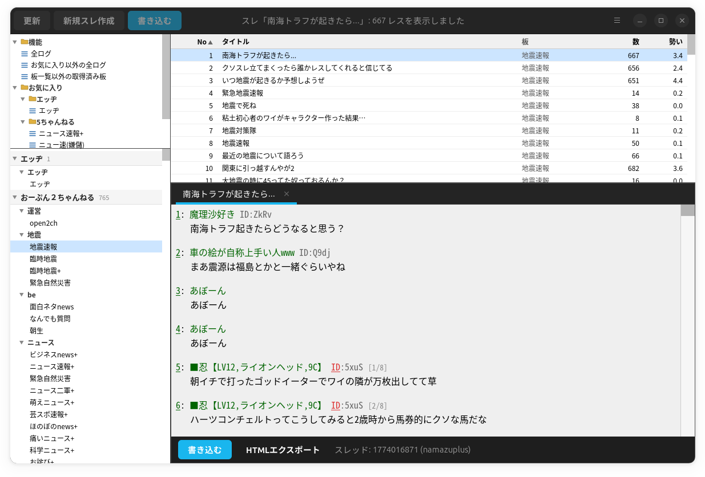

# ChBrowser Linux (chbrowser-linux)

Linux (GNOME / GTK4 / libadwaita / WebKitGTK 6.0) 向けにネイティブ最適化されたモダンなマルチペイン BBS ブラウザです。

Windows 向け BBS ブラウザ [pawapawa041950/chbrowser](https://github.com/pawapawa041950/chbrowser/) の通信・閲覧コアロジックおよび Web 表示アセットを継承し、Linux デスクトップの作法（GNOME HIG、XDG Base Directory、Wayland/HiDPI、ダークモード自動追従）に合わせてフルネイティブに再構築されています。

<div align="center">
  
</div>

---

## 主な特徴

- **GNOME / GTK4 ネイティブ 4 ペイン構成**
  - かちゅ～しゃや Jane などの伝統的な 4 ペイン配置（画面左上: お気に入り、左下: 板一覧、中央: スレッド一覧、右側: スレッド表示）を現代的な libadwaita の外観で提供。
  - レス順表示 / ツリー表示（重複あり・なし）の切り替えに対応。
- **国内主要掲示板に対応**
  - **5ちゃんねる / BBSPINK** (`5ch.io`, `bbspink.com`)
  - **5ちゃんねる** (`5ch.io`)
  - **おーぷん２ちゃんねる** (`open2ch.net`)
  - **エッヂ掲示板** (`bbs.eddibb.cc`)
  - **まちBBS** (`machi.to`)
- **単独・完全ローカル動作**
  - クラウドや外部中継サーバを一切介さず、お使いの PC から各掲示板へ直接通信。
  - 一度取得したスレッドや画像はすべてローカルに保持され、オフラインでも過去ログ・画像の閲覧が可能。
- **自由なストレージ・パス設定**
  - Linux の標準規格（XDG Base Directory）に準拠。
  - 「設定」→「一般」より、**「データルートディレクトリ」**（デフォルト: `$HOME/.cache/chbrowser/data`）および**「画像/動画キャッシュ」**の保存先ディレクトリをユーザーが自由に指定可能。
- **完全自己完結型 HTML エクスポート**
  - スレッド一覧の右クリック、またはスレッド表示タブのボタンから、CSS・JavaScript・レイアウトが単一ファイルにインライン化されたスタンドアロンな HTML ファイルを出力。
  - 外部ネットワーク接続なしで、一般的なブラウザ（Chrome, Firefox 等）でいつでも綺麗にオフライン閲覧可能。
- **高度なログ・履歴機能**
  - お気に入り内の「機能」フォルダより、**「全ログ」「お気に入り以外の全ログ」「板一覧以外の取得済み板」**を一覧表示。
  - ネットワークエラー時や dat 落ちスレでもローカルキャッシュから自動フォールバック表示。
- **画像・動画キャッシュ & インラインビューア**
  - スレッド内の画像・動画の自動サムネイル表示・ポップアップ拡大。
  - キャッシュファイル名は `<ホスト名>_<パス>` 形式に正規化され、異なるサーバ間でのファイル名重複を防止。

---

## 画面構成

```
┌──────────────┬──────────────────────────┬─────────────────────────────────┐
│ お気に入り   │ スレッド一覧             │ スレッド表示ペイン              │
│ (左上ペイン) │ (中央ペイン)             │ (右側ペイン)                    │
│              │                          │                                 │
├──────────────┤ 各種ソート・フィルタ     │ タブ切り替え / レス・ツリー表示 │
│ 板一覧       │ レス数・既読・勢い表示   │ アンカー・IDポップアップ        │
│ (左下ペイン) │                          │ インライン画像・動画・ビューア  │
└──────────────┴──────────────────────────┴─────────────────────────────────┘
```

---

## 動作要件

本アプリはWebKitGTK 6.0が搭載されているLinux OS(Ubuntu24.04, Fedora, Arch Linux, Debian 12)に対応します。開発はUbuntu24.04上で行っています。

- **デスクトップ環境**: GNOME、Wayland、X11 に対応
- **依存パッケージ** (Ubuntu / Debian の場合):
  ```bash
  # GUI 共有ライブラリおよび日本語入力モジュール
  sudo apt install -y libgtk-4-1 libadwaita-1-0 libwebkitgtk-6.0-4 fcitx5-frontend-gtk4

  # .NET 8 SDK（ソースコードから直接ビルド・起動する場合に必要）
  sudo apt install -y dotnet-sdk-8.0
  ```
- **ランタイムについて**:
  - ソースコードから直接起動（`./tools/run-local.sh` 等）やビルド・発行を行う場合は **[.NET 8.0 SDK](https://dotnet.microsoft.com/download/dotnet/8.0)** が必要です。
  - 自己完結型単一バイナリ（`ChBrowser.Gtk`）や `.deb` パッケージから実行する場合は、ランタイムが内包されているため **dotnet のインストールは不要** です。

---

## 起動・インストール方法

### 1. ホスト環境で直接起動（推奨）

リポジトリ内のスクリプトを使用すると、ホスト環境でビルドして即座に起動できます（fcitx5 / ibus による日本語入力もそのまま動作します）:

```bash
./tools/run-local.sh
```

### 2. デスクトップ統合インストール

デスクトップランチャー（アプリケーション一覧）に登録し、アイコン付きで日常的に起動できるようにします:

```bash
# ユーザーローカル (~/.local/) にインストール
./tools/install-desktop.sh

# システム全体 (/usr/local/) にインストール
sudo ./tools/install-desktop.sh --system
```

インストール後は、アプリケーションメニューから「ChBrowser」を選択するか、ターミナルで `chbrowser` と入力するだけで起動できます。

アンインストールする場合:
```bash
./tools/install-desktop.sh --uninstall
```

### 3. ソースコードからの単一バイナリ発行（Publish）

配布用または単独実行用の自己完結型バイナリ（Self-contained Single File）を作成する場合（アーキテクチャに応じて `-r linux-x64` または `-r linux-arm64` を指定）:

```bash
# x86_64 (amd64) 環境の場合:
dotnet publish src/ChBrowser.Gtk/ChBrowser.Gtk.csproj \
  -c Release \
  -r linux-x64 \
  --self-contained true \
  -p:PublishSingleFile=true

# ARM64 (aarch64) 環境の場合:
dotnet publish src/ChBrowser.Gtk/ChBrowser.Gtk.csproj \
  -c Release \
  -r linux-arm64 \
  --self-contained true \
  -p:PublishSingleFile=true
```

出力先: `src/ChBrowser.Gtk/bin/Release/net8.0/<RID>/publish/ChBrowser.Gtk`

### 4. Debian パッケージ（.deb）の作成とインストール

Ubuntu や Debian 向けの `.deb` インストーラーパッケージを作成する場合:

```bash
# .deb パッケージの生成 (出力: dist/chbrowser_<version>_<arch>.deb)
./tools/build-deb.sh

# パッケージのインストール
sudo apt install ./dist/chbrowser_0.1.0_*.deb

# アンインストールする場合
sudo apt remove chbrowser
```

### 5. 包括自動検証テストの実行

コンテナ環境を利用したデスクトップメタデータ検証、Core 単体テスト、GTK4 ヘッドレス起動検証、HTML エクスポート検証の実行:

```bash
./tools/run-verification.sh
```

---

## データの保存場所

本アプリは Linux の標準規格（XDG Base Directory）に従って各データを管理します：

| データの種類 | 保存先ディレクトリ | 備考 |
| :--- | :--- | :--- |
| **設定・お気に入り・NG** | `$HOME/.config/chbrowser/` | `config.json`, `favorites.json`, `ng/rules.json` など |
| **データルート（スレッド・ログ）** | `$HOME/.cache/chbrowser/data/` | 各板の dat ファイル、`_subject.txt`、書き込みログ（※設定で変更可能） |
| **画像・動画キャッシュ** | `$HOME/.cache/chbrowser/images/`, `videos/` | ダウンロード済み画像・動画、サムネイル（※設定で変更可能） |
| **ブラウザセッション・Cookie** | `$HOME/.cache/chbrowser/webkit/` | WebKitGTK のキャッシュ・永続化 Cookie |

> **保存先ディレクトリのカスタマイズ**:
> 右上のメインメニュー「設定」→「一般」→「ストレージとパス」より、「データルートディレクトリ」および「画像/動画キャッシュ」の保存先を好きなローカルフォルダにいつでも変更・既定へリセットできます。

---

## 設定項目

メインメニュー（右上のハンバーガーボタン）→「設定」より各種カスタマイズが可能です：

- **一般**: データルートディレクトリ、画像/動画キャッシュの保存先変更、前回開いていたタブの自動復元。
- **掲示板**:
  - 表示する掲示板プロバイダー（エッヂ、5ch、まちBBS、おーぷん2ch）の表示/非表示および並び順の変更（▲/▼ボタン）。
  - 各掲示板の接続先 URL（bbsmenu やエッヂのベース URL）。
- **外観・フォント**: フォントサイズやテーマ設定。

---

## ディレクトリ構成

```
chbrowser-linux/
├── src/
│   ├── ChBrowser.Core/     # プラットフォーム共通コアライブラリ
│   │   ├── Models/         # データモデル (Post, Board, AppConfig 等)
│   │   ├── Services/       # BBS通信、ストレージ、画像キャッシュ、HTML出力
│   │   └── Resources/      # スレッド・一覧・ビューア用 HTML / CSS / JS テンプレート
│   └── ChBrowser.Gtk/      # Linux / GTK4 / libadwaita ネイティブ UI
│       ├── MainWindow.cs   # メイン 4 ペインウィンドウ、ヘッダーバー
│       ├── Panes/          # 各ペイン (お気に入り、板一覧、スレ一覧、スレ表示)
│       ├── Dialogs/        # 各種ダイアログ
│       ├── PreferencesDialog.cs # libadwaita 製設定画面
│       └── LocalAssetServer.cs  # WebKitGTK 向けローカルアセット配信用サーバ
├── tests/
│   └── ChBrowser.Core.Tests/ # 単体テストプロジェクト (xUnit)
├── tools/                  # 起動スクリプト、インストール、自動検証スクリプト
└── data/                   # アプリアイコン、デスクトップエントリ、metainfo
```

---

## 免責事項

- 本ソフトウェアは各掲示板（5ch.io, bbspink.com, eddibb.cc, machi.to, open2ch.net）の仕様に依存します。各掲示板サーバ側の仕様変更により動作しなくなる可能性があります。
- 本ソフトウェアは各掲示板（5ch.io, eddibb.cc, machi.to, open2ch.net）の仕様に依存します。各掲示板サーバ側の仕様変更により動作しなくなる可能性があります。
- 本ソフトウェアは非公式クライアントであり、各掲示板の運営元とは一切関係ありません。
- ご利用は自己責任でお願いいたします。

---

## ライセンス・謝辞

- **ライセンス**: 本プロジェクトは [MIT License](LICENSE) の下で公開されています。
- **オリジナルプロジェクト**: 本プロジェクトは [pawapawa041950/chbrowser](https://github.com/pawapawa041950/chbrowser/) をベースに Linux / GTK4 向けに移植・開発されたものです。優れたコア設計とリソースを提供してくださったオリジナル作者様に深く感謝いたします。
